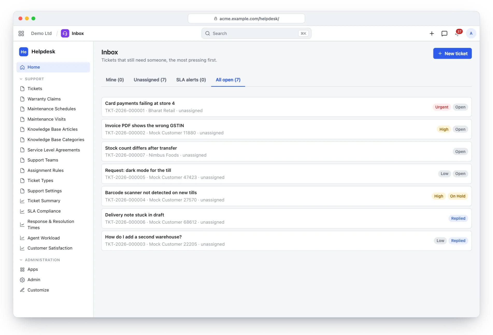
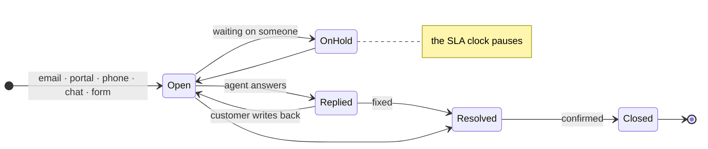
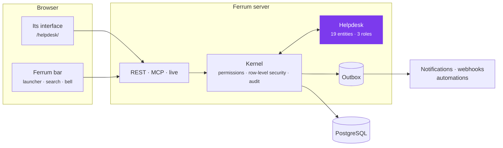
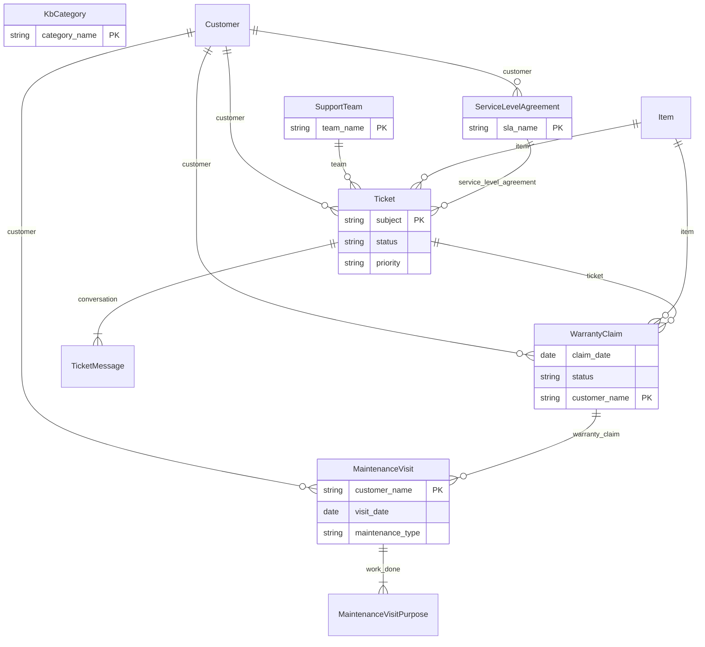

<div align="center">

<picture>
  <source media="(prefers-color-scheme: dark)" srcset="docs/assets/banner-dark.svg">
  
</picture>

[](https://github.com/CBFerrum/ferrum-app-helpdesk/actions/workflows/ci.yml)      

**A native app for [Ferrum](https://github.com/CBFerrum/Ferrum), the open-source, AI-first business platform.**

[Overview](#overview) · [Highlights](#highlights) · [Screenshots](#screenshots) · [How it works](#how-it-works) · [Data model](#data-model) · [Install](#install) · [Develop](#develop) · [Changelog](#changelog)

</div>

---

## Overview

Ferrum Helpdesk is a support desk built on Ferrum's customers, items and serial numbers.
Tickets arrive by email, portal, phone, chat or web form; service level agreements count business
hours, holidays and paused statuses; assignment rules share work fairly even when tickets arrive
together; and answers your team writes once become knowledge base articles customers can find.


| At a glance | |
|---|---|
| 📦 Version | `0.4.1` |
| 🧱 Platform | Ferrum `>=0.3.2, <0.4` |
| 🔗 Requires | nothing else |
| 🖥️ Interface | its own, at `/helpdesk/` |
| 🗃️ Records | 19 entities in 2 packages |
| 👥 Roles | 3: Support Agent, Support Manager, Knowledge Base Editor |
| 📊 Reports | 5 |
| 🧪 Tests | 23 Rust tests, 1 interface test file |


## Highlights

<table>
<tr>
<td width="50%" valign="top">

### 📥 One inbox for every channel
Email, portal, phone, chat and web forms, with conversations, statuses and satisfaction ratings.

</td>
<td width="50%" valign="top">

### ⏱️ SLAs on business hours
Working hours, holidays and time zones; pausing statuses; response and resolution breach tracking.

</td>
</tr>
<tr>
<td width="50%" valign="top">

### ⚖️ Fair assignment
Teams with round-robin or least-loaded rules that stay correct under concurrent tickets.

</td>
<td width="50%" valign="top">

### 📚 Knowledge base
Categories, publishing and helpful votes, so answers are written once.

</td>
</tr>
<tr>
<td width="50%" valign="top">

### 🛡️ Warranty and maintenance
Claims checked against serial-number deliveries; maintenance schedules and visits.

</td>
<td width="50%" valign="top">

### 📊 Service reports
Ticket summary, SLA compliance, response and resolution times, agent workload, satisfaction.

</td>
</tr>
</table>

## Screenshots

<picture>
  <source media="(prefers-color-scheme: dark)" srcset="docs/assets/helpdesk-dark.webp">
  
</picture>

<p align="center"><sub>The inbox: open tickets by priority with their SLA and customer.</sub></p>

> [!TIP]
> The screenshots follow your GitHub theme: switch between light and dark to see both.

## How it works

### A ticket's life



### Inside Ferrum



Everything Helpdesk adds is ordinary Ferrum metadata and Rust: its records get lists, forms,
search, permissions, an audit trail, exports and the REST and MCP APIs for free, so AI agents work
with them under the same rules as people.

### What it adds to Ferrum

| Where | What |
|---|---|
| 🚀 Launcher | **Helpdesk** at `/helpdesk/` |
| ➕ Create menu | Ticket |
| 🔔 Notification | Tickets assigned to you |
| 🔔 Notification | Customer replies on your tickets |
| 🔔 Notification | SLA breaches on your tickets |
| ✅ My work | Your tickets |
| 🧑‍💼 Portal | Your tickets |

## Data model

The main records and how they connect (19 entities in all; `packages/` has every field).



### Roles

| Role | What it is for | Entities |
|---|---|---|
| **Support Agent** | Works tickets, writes knowledge base articles, logs warranty claims and maintenance visits. Give the user Support Team scopes to limit them to their teams' tickets. | 13 |
| **Support Manager** | Everything in support, including SLAs, assignment rules, teams and maintenance contracts. | 16 |
| **Knowledge Base Editor** | Writes and publishes knowledge base articles and organizes their categories. | 2 |

<details>
<summary><b>Reports (5)</b></summary>

- Support Ticket Summary
- Support Sla Compliance
- Support Response Times
- Support Agent Workload
- Support Customer Satisfaction

</details>

## Install

Workspace administrators install it from **Apps** (`/store/`) in Ferrum; it ships in the
official Ferrum server image. Self-hosters building their own image enable the
`helpdesk` feature of the server. Everything it adds is also available to AI agents over
Ferrum's MCP server, within each person's permissions.

## Develop

Clone it next to the platform:

```text
work/
├── ferrum/            https://github.com/CBFerrum/Ferrum (with Ferrum-Frontend cloned into ferrum/web)
└── ferrum-app-helpdesk/
```

Point the platform dependencies at your checkout (this file is git-ignored):

```toml
# .cargo/config.toml
[patch."https://github.com/CBFerrum/Ferrum"]
ferrum-apps = { path = "../ferrum/crates/apps" }
ferrum-domain = { path = "../ferrum/crates/domain" }
ferrum-kernel = { path = "../ferrum/crates/kernel" }
ferrum-meta = { path = "../ferrum/crates/meta" }
```

The tests need PostgreSQL with an ordinary (non-superuser) role, so row-level security
applies:

```bash
createuser ferrum --pwprompt && createdb -O ferrum ferrum_helpdesk_test
cargo test
```

`FERRUM_HELPDESK_TEST_DATABASE_URL` overrides the database URL.


The interface lives in `ui/` and builds with Ferrum-Frontend's packages:

```bash
cd ui
npm run build      # ui/dist, checked against the size budget
npm test
```

With a development server started with `FERRUM_DEV_UI=1`, `ferrum-app dev --ui` serves the pages
from Vite behind the real bar and session, with hot reload.


### Project layout

```text
app.yaml      the manifest: id, version, requirements, what it adds to Ferrum
packages/     metadata: entities, roles, reports, workflows, print formats
src/          the app's logic in Rust: hooks, actions, endpoints, upkeep jobs
ui/           its own interface (React + Vite), built into ui/dist
tests/        integration tests against a real PostgreSQL
CHANGELOG.md  what changed in each version
```

## Changelog

| Version | Highlights |
|---|---|
| **0.4.1** | The interface starts faster: its first download holds the frame and the app's own pages, and lists, forms, reports and other apps' screens load … |
| **0.4.0** | A page of the workspace's portal, "Your tickets" at /portal/tickets/: the tickets raised from the address a customer signed in with, each with its … |
| **0.3.2** | Rebuilt with Ferrum-Frontend a8d4dda: under the platform's bar the records frame no longer shows a second bell (the bar has notifications). |
| **0.3.1** | Its notifications have kinds each person chooses for (Ferrum's bell, apps-ui.md U5): tickets assigned to you, customer replies on your tickets and … |

Every version is in [CHANGELOG.md](CHANGELOG.md).

## License

[AGPL-3.0-only](LICENSE), like the platform. Part of [Ferrum](https://github.com/CBFerrum/Ferrum) ·
[Report an issue](https://github.com/CBFerrum/ferrum-app-helpdesk/issues)
