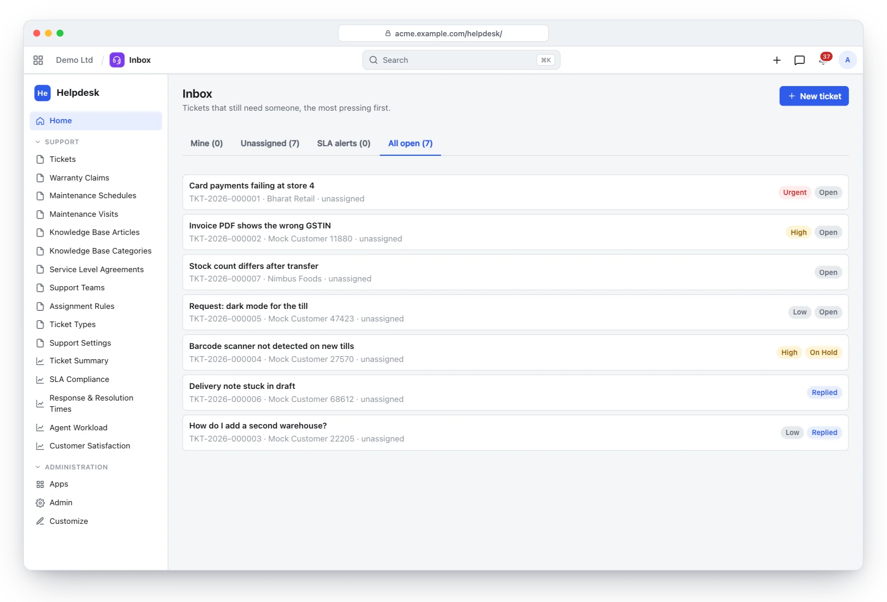
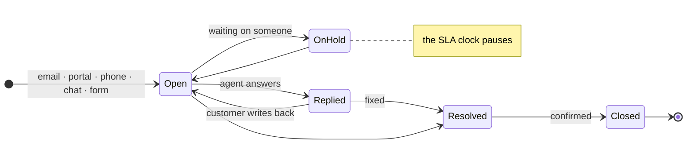
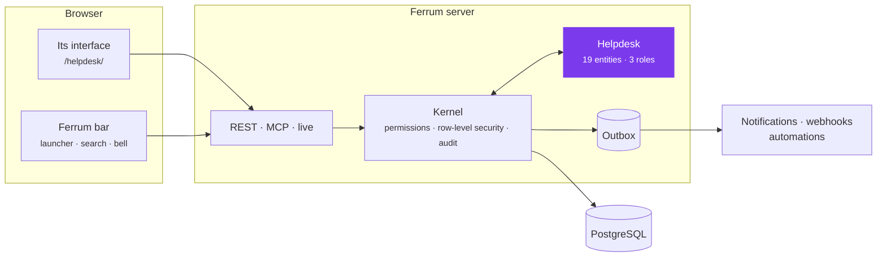
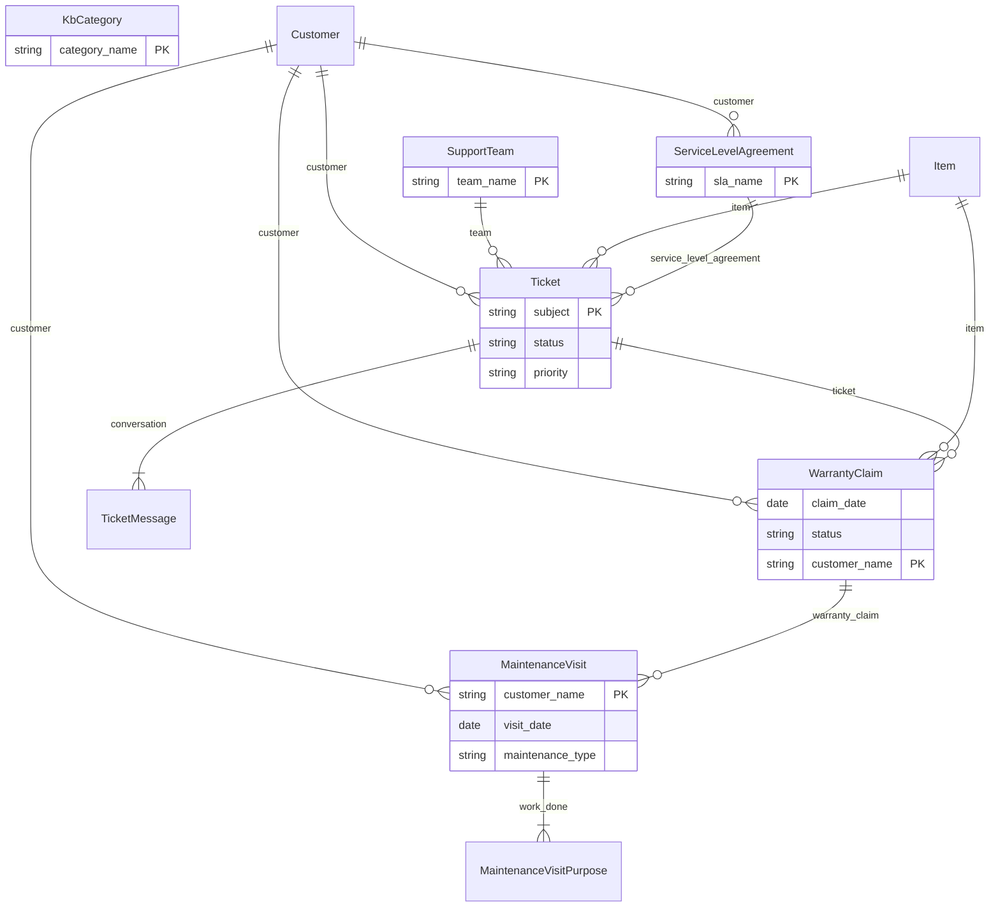

<div align="center">

<picture>
  <source media="(prefers-color-scheme: dark)" srcset="docs/assets/banner-dark.svg">
  
</picture>

[](https://github.com/CBFerrum/ferrum-app-helpdesk/actions/workflows/ci.yml)      

**A native app for [Ferrum](https://github.com/CBFerrum/Ferrum), the open-source, AI-first business platform.**

[Overview](#overview) · [Highlights](#highlights) · [Screenshots](#screenshots) · [How it works](#how-it-works) · [Data model](#data-model) · [Install](#install) · [Develop](#develop) · [Changelog](#changelog)

</div>

---

## Overview

Ferrum Helpdesk is a support desk built on Ferrum's customers, items and serial numbers.
Tickets arrive by email, portal, phone, chat or web form; service level agreements count business
hours, holidays and paused statuses; assignment rules share work fairly even when tickets arrive
together; and answers your team writes once become knowledge base articles customers can find.


| At a glance | |
|---|---|
| 📦 Version | `0.4.1` |
| 🧱 Platform | Ferrum `>=0.3.2, <0.4` |
| 🔗 Requires | nothing else |
| 🖥️ Interface | its own, at `/helpdesk/` |
| 🗃️ Records | 19 entities in 2 packages |
| 👥 Roles | 3: Support Agent, Support Manager, Knowledge Base Editor |
| 📊 Reports | 8 |
| 🧪 Tests | 23 Rust tests, 1 interface test file |


## Highlights

<table>
<tr>
<td width="50%" valign="top">

### 📥 One inbox for every channel
Email, portal, phone, chat and web forms, with conversations, statuses and satisfaction ratings.

</td>
<td width="50%" valign="top">

### 🔀 Merging duplicates
Tickets of one customer merge into one: conversation in time order, each message marked with where it came from, with files, watchers and tags; the duplicates close as merged and their customer's replies land on the survivor. A merge is not undone.

### ⏱️ Targets on the platform's clock
First response and resolution are Ferrum's service targets on a working calendar (hours, time zone with daylight saving, dated exceptions): each agreement names its own, else the workspace's `helpdesk_hours`; agreements by priority, customer, group or team; the clock starts when the ticket was opened and stops while the customer is asked; each breach recorded once and raising the ticket's updated event.

</td>
</tr>
<tr>
<td width="50%" valign="top">

### ⚖️ Fair assignment
Teams with round-robin or least-loaded rules that stay correct under concurrent tickets.

</td>
<td width="50%" valign="top">

### 📚 Knowledge base
Categories, publishing and helpful votes, so answers are written once.

</td>
</tr>
<tr>
<td width="50%" valign="top">

### 🛡️ Warranty and maintenance
Claims checked against serial-number deliveries; maintenance schedules and visits.

</td>
<td width="50%" valign="top">

### 📊 Service reports
Ticket summary, SLA compliance, response and resolution times, agent workload, satisfaction by agent, team and month, backlog by age, volume by channel, tag or customer, and the reopen rate.

</td>
</tr>
</table>

## Screenshots

<picture>
  <source media="(prefers-color-scheme: dark)" srcset="docs/assets/helpdesk-dark.webp">
  
</picture>

<p align="center"><sub>The inbox: open tickets by priority with their SLA and customer.</sub></p>

> [!TIP]
> The screenshots follow your GitHub theme: switch between light and dark to see both.

## How it works

### A ticket's life



### Inside Ferrum



Everything Helpdesk adds is ordinary Ferrum metadata and Rust: its records get lists, forms,
search, permissions, an audit trail, exports and the REST and MCP APIs for free, so AI agents work
with them under the same rules as people.

### Customers writing to support

Add a **Support Address** for each address customers write to (support@, billing@), mapped to a team and, if you like, a **Brand** (a name, a reply signature and a wrapper around replies). Helpdesk registers each address with the Mail app (version 0.20 or later, `ferrum_app_comms::routes`) and keeps the registration in step as addresses are added, changed, disabled or deleted (an address Mail will not take says why on the address). Mail then hands each message for one to Helpdesk, once, with the headers it kept; there is no hook on Mail's records. Do not set the mailbox's "create records" option: Helpdesk's addresses do that.

A reply is matched to its ticket by the Message-ID it answers (In-Reply-To, References), then by the ticket's secret in the address it was written to (`support+<secret>@acme.test`, the Reply-To of what Helpdesk sends), and last by the number and secret in the subject's tag. Auto-replies, bounces and list mail are recognised by the headers Mail stored. Mail the mail server could not verify (`x-ferrum-auth: unverified`) from a known customer, or from the requester or a copy of the ticket it answers, is held in the Inbound Mail Log for staff (Support Settings, Mail That Fails Authentication: Hold Failed by default, Hold All Unverified, or Accept): a forged sender must not read or steer a ticket. Mail with no authentication result at all is taken and marked not verified on the message. An administrator reads the held mail's body in the log (the field group `held_mail`).

Replies go out through Mail with `outbound::send`: a Reply-To that routes back, In-Reply-To and References from the conversation, the support address's Mail account, the brand's name, signature and wrapper; the Message-ID Mail gave the message is kept on the conversation row.

### What it adds to Ferrum

| Where | What |
|---|---|
| 🚀 Launcher | **Helpdesk** at `/helpdesk/` |
| ➕ Create menu | Ticket |
| 🔔 Notification | Tickets assigned to you |
| 🔔 Notification | Customer replies on your tickets |
| 🔔 Notification | SLA breaches on your tickets |
| ✅ My work | Your tickets |
| 🧑‍💼 Portal | Your tickets |

## Data model

The main records and how they connect (19 entities in all; `packages/` has every field).



### Roles

| Role | What it is for | Entities |
|---|---|---|
| **Support Agent** | Works tickets, writes knowledge base articles, logs warranty claims and maintenance visits. Give the user Support Team scopes to limit them to their teams' tickets. | 13 |
| **Support Manager** | Everything in support, including SLAs, assignment rules, teams and maintenance contracts. | 16 |
| **Knowledge Base Editor** | Writes and publishes knowledge base articles and organizes their categories. | 2 |

<details>
<summary><b>Reports (5)</b></summary>

- Support Ticket Summary
- Support Sla Compliance
- Support Response Times
- Support Agent Workload
- Support Customer Satisfaction

</details>

## Install

Workspace administrators install it from **Apps** (`/store/`) in Ferrum; it ships in the
official Ferrum server image. Self-hosters building their own image enable the
`helpdesk` feature of the server. Everything it adds is also available to AI agents over
Ferrum's MCP server, within each person's permissions.

## Develop

Clone it next to the platform:

```text
work/
├── ferrum/            https://github.com/CBFerrum/Ferrum (with Ferrum-Frontend cloned into ferrum/web)
└── ferrum-app-helpdesk/
```

Point the platform dependencies at your checkout (this file is git-ignored):

```toml
# .cargo/config.toml
[patch."https://github.com/CBFerrum/Ferrum"]
ferrum-apps = { path = "../ferrum/crates/apps" }
ferrum-domain = { path = "../ferrum/crates/domain" }
ferrum-kernel = { path = "../ferrum/crates/kernel" }
ferrum-meta = { path = "../ferrum/crates/meta" }
```

The tests need PostgreSQL with an ordinary (non-superuser) role, so row-level security
applies:

```bash
createuser ferrum --pwprompt && createdb -O ferrum ferrum_helpdesk_test
cargo test
```

`FERRUM_HELPDESK_TEST_DATABASE_URL` overrides the database URL.


Its tests also build on [ferrum-app-erp](https://github.com/CBFerrum/ferrum-app-erp), which Cargo takes from GitHub.
To work on it alongside this app, clone it into the same folder and add to the same file:

```toml
[patch."https://github.com/CBFerrum/ferrum-app-erp"]
ferrum-app-erp = { path = "../ferrum-app-erp" }
```


The interface lives in `ui/` and builds with Ferrum-Frontend's packages:

```bash
cd ui
npm run build      # ui/dist, checked against the size budget
npm test
```

With a development server started with `FERRUM_DEV_UI=1`, `ferrum-app dev --ui` serves the pages
from Vite behind the real bar and session, with hot reload.


### Project layout

```text
app.yaml      the manifest: id, version, requirements, what it adds to Ferrum
packages/     metadata: entities, roles, reports, workflows, print formats
src/          the app's logic in Rust: hooks, actions, endpoints, upkeep jobs
ui/           its own interface (React + Vite), built into ui/dist
tests/        integration tests against a real PostgreSQL
CHANGELOG.md  what changed in each version
```

## Changelog

| Version | Highlights |
|---|---|
| **0.10.3** | The screens for 0.10.2: brands and a brand on each support address, whether Mail took an address and why not, a working calendar per service agreement and on the target cards, held mail's text and the reason it is held, what to do with mail that fails authentication, a mark on messages whose sender was not verified, and the article report. |
| **0.10.2** | Hours per agreement are back (each agreement names its own working calendar; a workspace's old hours, holidays and time zones are recreated as calendars when it is updated; a target's clock starts from when the ticket was opened), inbound mail through Mail's registrations (Reply-To that routes back, threading by headers then by the address's secret, mail that fails authentication held), the platform's calls for tags, calendars and files, the help centre counts its public visitors' views and votes with a report by article, brands on support addresses, the held mail's body for administrators, unanswered time in working hours, and surveys that respect opt-outs. |
| **0.10.1** | The screens for 0.9 and 0.10: the ticket page reads the platform's target states and tells public replies from internal notes, with tags, copies, rating and the ticket it follows up; saved replies filled in by the server, macros previewed before they are applied, the agent's signature; queues by tag and by target state with bulk tag and macro; Administration (support addresses, inbound log, agent profiles, tags, assignment rules, macros, satisfaction survey); the help centre's editor and the portal's article search; reports as the questions a desk asks. |
| **0.10.0** | Customers write to support addresses and it lands in the ticket (new ticket or a reply matched by headers or the subject's secret, copies and files kept, loops and noise logged), targets on the platform's clock, tags and private notes, routing by skill, language and shift, macros and filled-in replies, ratings by a signed link, a help centre, and backlog, volume and reopen reports. |
| **0.9.1** | Screens for merging tickets: select tickets in the inbox or tick a customer's other tickets on one, choose the one that stays, and read what moves; a merged ticket links to the survivor and its messages say where they came from. |
| **0.9.0** | Merge duplicate tickets: the conversation, files, watchers and tags move to the surviving ticket, the duplicate closes as merged and a customer's reply to it lands on the survivor. |
| **0.8.2** | Rebuilt on the tuned design system: better menu icons, a lighter first page, a visible scroll cue, cleaner print. |
| **0.8.1** | The redesigned interface: the upgraded design system, shaped loading, told-apart states. |
| **0.8.0** | Work outside a customer's entitlement can wait for a Support Manager's approval (Support Settings), with no reply to the customer until it is approved or declined, saying why. |
| **0.7.13** | Its reports' names in Arabic and Hindi. |
| **0.7.12** | Its names in Arabic and Hindi; the last English sentences translated. |
| **0.7.11** | Sentences built in code are words too, in Arabic and Hindi. |
| **0.7.10** | The assistant knows its records. |
| **0.7.9** | Rebuilt with Ferrum-Frontend 5b22e7b: its own words in Arabic and Hindi. |
| **0.7.8** | Rebuilt with Ferrum-Frontend 6537d65: once-shown answers kept; English isolated right to left; its own words translatable by a workspace. |
| **0.7.7** | Rebuilt with Ferrum-Frontend d5d98f2: a workspace's own interface words; pictures in attachment fields; a duplicate value said so; its own screens mirror right to left. |
| **0.7.6** | Rebuilt with Ferrum-Frontend 63280d3: right to left, pages mirror; the records pages' words in Arabic and Hindi. |
| **0.7.5** | Rebuilt with Ferrum-Frontend a64416a: a box whose default is 1 shows ticked. |
| **0.7.4** | Rebuilt with Ferrum-Frontend 922fcfb: action dialogs say every refusal and ask once. |
| **0.7.3** | Rebuilt with Ferrum-Frontend a76295e: times on a person's own clock when they chose one. |
| **0.7.2** | Times on the workspace's clock; rebuilt with Ferrum-Frontend 24c3951. |
| **0.7.1** | Rebuilt with Ferrum-Frontend bb60115: empty numbers read as the server reads them; settings open as their record. |
| **0.7.0** | Files on the portal stream from storage, whatever their size. |
| **0.6.3** | Rebuilt with Ferrum-Frontend 00dea07: a workflow state's kept fields are read-only, its needed ones required. |
| **0.6.2** | Rebuilt with Ferrum-Frontend daeadda: after an action runs, a record page shows what the action said it did rather than only that it is done. |
| **0.6.1** | Rebuilt with Ferrum-Frontend 80ff179: a field's label names its control for assistive technology, and a record whose title is a link shows that record's title, … |
| **0.6.0** | A ticket opens as one conversation: what the customer wrote, every reply and internal note, and what happened to the ticket between them (its status, who took … |
| **0.5.0** | Escalation rules, and support contracts that say what a customer is entitled to. |
| **0.4.1** | The interface starts faster: its first download holds the frame and the app's own pages, and lists, forms, reports and other apps' screens load … |
| **0.4.0** | A page of the workspace's portal, "Your tickets" at /portal/tickets/: the tickets raised from the address a customer signed in with, each with its … |
| **0.3.2** | Rebuilt with Ferrum-Frontend a8d4dda: under the platform's bar the records frame no longer shows a second bell (the bar has notifications). |
| **0.3.1** | Its notifications have kinds each person chooses for (Ferrum's bell, apps-ui.md U5): tickets assigned to you, customer replies on your tickets and … |

Every version is in [CHANGELOG.md](CHANGELOG.md).

## License

[AGPL-3.0-only](LICENSE), like the platform. Part of [Ferrum](https://github.com/CBFerrum/Ferrum) ·
[Report an issue](https://github.com/CBFerrum/ferrum-app-helpdesk/issues)
